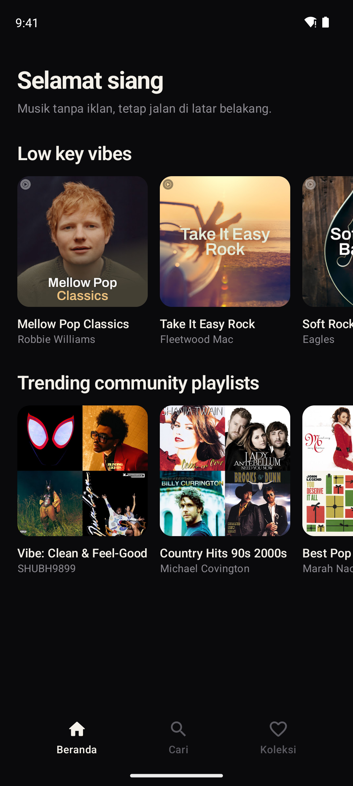
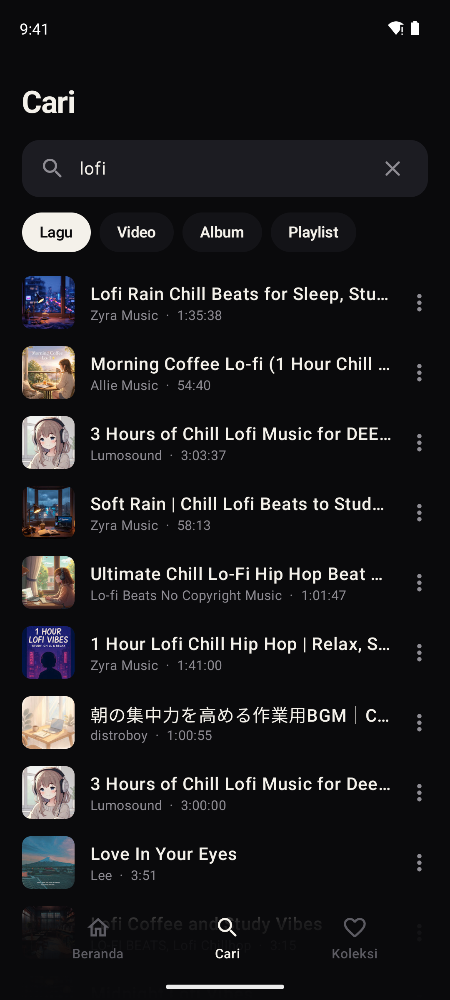
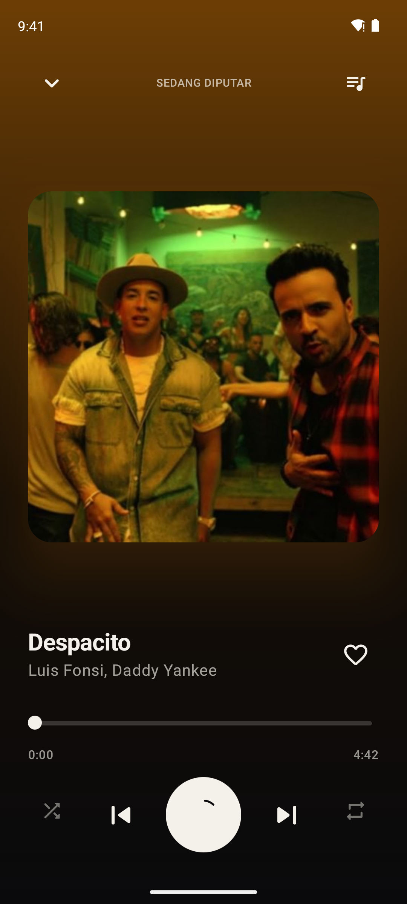
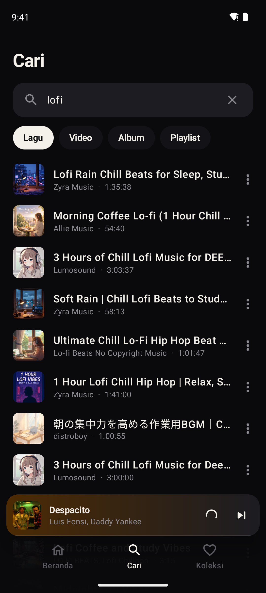

# iYou: Musik YouTube Tanpa Iklan, Tetap Jalan Saat Layar Mati

Pernah kesal karena lagu di YouTube berhenti begitu layar HP dimatikan? Atau karena iklan muncul di tengah lagu? Saya juga, jadi saya membuat aplikasi sendiri: **iYou**.

iYou adalah aplikasi Android kecil untuk mendengarkan musik dari YouTube Music. Aplikasi ini **tanpa iklan**, **tetap memutar di latar belakang** dan **tampilannya sederhana**. Fiturnya sengaja dibuat sedikit: hanya yang benar-benar dipakai sehari-hari.

  
  
  
  

## Fitur

- **Tanpa iklan.** Lagu diputar langsung, tanpa jeda iklan.
- **Putar di latar belakang.** Musik tetap jalan saat layar mati atau saat Anda membuka aplikasi lain. Kontrolnya ada di notifikasi dan layar kunci.
- **Beranda berisi rekomendasi** dari YouTube Music: lagu populer, playlist dan album.
- **Pencarian** lagu, video, album dan playlist, lengkap dengan saran kata kunci dan riwayat pencarian.
- **Pemutar layar penuh** dengan warna latar yang mengikuti sampul lagu, plus shuffle, repeat dan pengaturan antrean.
- **Radio otomatis.** Setelah satu lagu diputar, lagu-lagu yang mirip langsung masuk ke antrean.
- **Koleksi lokal.** Simpan lagu favorit dengan ♡ dan lihat riwayat putar. Tidak perlu login atau akun Google.
- **Buka tautan YouTube langsung.** Bagikan link YouTube atau YouTube Music ke iYou, dan lagunya langsung diputar.
- **Ringan dan hemat kuota.** Yang diambil hanya audionya, dan lagu yang sudah pernah diputar disimpan di cache.

## Download

**[⬇️ Download iYou versi terbaru (APK)](https://github.com/bozid95/youtubro/releases/latest)**

Di halaman tersebut, pilih file **`iyou-release.apk`**.

Syarat: HP Android **8.0 (Oreo) atau lebih baru**.

## Cara Install

1. Download file `iyou-release.apk` dari link di atas.
2. Buka file tersebut dari notifikasi download atau aplikasi **File**.
3. Jika muncul peringatan *"Install aplikasi tidak dikenal"*, ketuk **Setelan**, lalu aktifkan **Izinkan dari sumber ini** untuk browser atau file manager Anda.
4. Ketuk **Install**, lalu buka iYou.
5. Saat pertama kali dibuka, izinkan **notifikasi** supaya kontrol musik muncul di notifikasi dan layar kunci.

> Muncul peringatan dari Play Protect? Itu wajar untuk aplikasi yang tidak berasal dari Play Store. Ketuk **Tetap install**.

## Tips Pemakaian

- **Tekan lama** atau ketuk **⋮** pada sebuah lagu untuk *Putar berikutnya*, *Tambah ke antrean*, *Mulai radio* atau *Suka*.
- **Geser ke atas** mini player untuk membuka pemutar layar penuh. Tekan **Back** untuk mengecilkannya lagi.
- Di aplikasi YouTube, ketuk **Bagikan → iYou**, dan video tersebut langsung diputar sebagai musik.
- Jika beranda gagal dimuat, **tarik layar ke bawah** untuk memuat ulang. Jika masih gagal, coba matikan VPN, Private DNS atau ad blocker sebentar.

## Open Source

iYou bersifat open source dengan lisensi **GPL-3.0**. Kode lengkapnya ada di GitHub:
**[github.com/bozid95/youtubro](https://github.com/bozid95/youtubro)**

Dibuat dengan Kotlin, Jetpack Compose dan Media3 (ExoPlayer). Data musik diambil dengan bantuan proyek open source [Mochy Music](https://github.com/realidkroo/Mochy-Music), [InnerTubeX](https://github.com/MetrolistGroup/innertubex) dan [NewPipeExtractor](https://github.com/TeamNewPipe/NewPipeExtractor). Terima kasih untuk para pengembangnya.

## Catatan

iYou adalah proyek pribadi dan **tidak berafiliasi dengan YouTube atau Google**. Aplikasi ini tidak tersedia di Play Store. Gunakan dengan bijak dan untuk keperluan pribadi saja. Jika Anda menyukai seorang musisi, dukung mereka lewat layanan resmi.

Ada masukan atau menemukan bug? Silakan tulis di [halaman Issues GitHub](https://github.com/bozid95/youtubro/issues) atau di kolom komentar di bawah. 🎧
