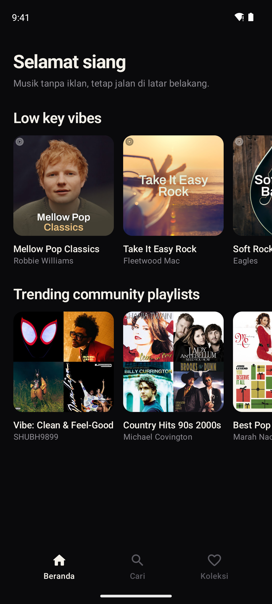
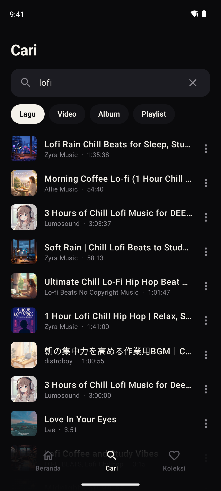
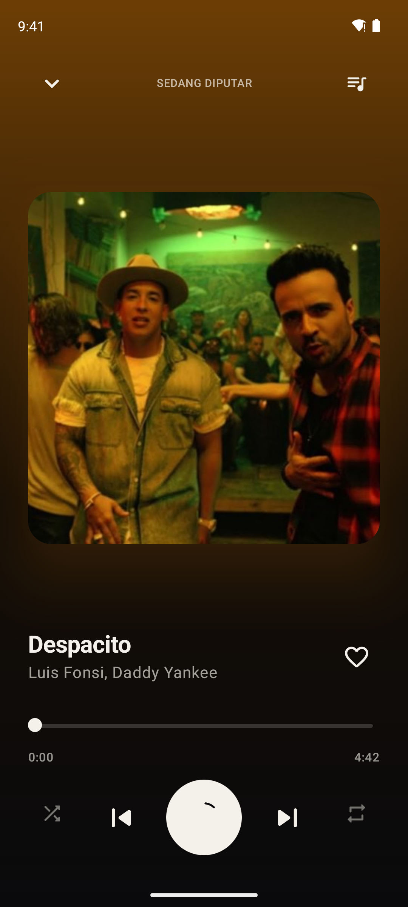
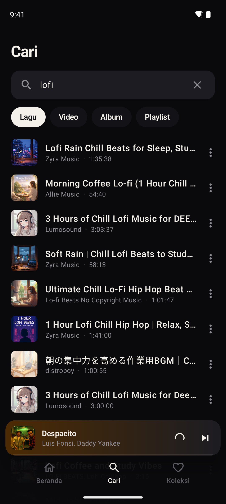

# Youtubro: Musik & Video YouTube Tanpa Iklan, Tetap Jalan Saat Layar Mati

Pernah kesal karena lagu di YouTube berhenti begitu layar HP dimatikan? Atau karena iklan muncul di tengah lagu? Saya juga, jadi saya membuat aplikasi sendiri: **Youtubro**.

Youtubro adalah aplikasi Android kecil untuk mendengarkan musik dari YouTube Music, dan kalau mau, sekalian menonton videonya. Aplikasi ini **tanpa iklan**, **tetap memutar di latar belakang** dan **tampilannya sederhana**. Fiturnya sengaja dibuat sedikit: hanya yang benar-benar dipakai sehari-hari.

| Beranda | Pencarian | Pemutar | Mini player |
|:---:|:---:|:---:|:---:|
|  |  |  |  |

## Fitur

- **Tanpa iklan.** Lagu diputar langsung, tanpa jeda iklan.
- **Putar di latar belakang.** Musik tetap jalan saat layar mati atau saat Anda membuka aplikasi lain. Kontrolnya ada di notifikasi dan layar kunci.
- **Beranda berisi rekomendasi** dari YouTube Music: lagu populer, playlist dan album.
- **Pencarian** lagu, video, album dan playlist, lengkap dengan saran kata kunci dan riwayat pencarian.
- **Pemutar layar penuh** dengan warna latar yang mengikuti sampul lagu, plus shuffle, repeat dan pengaturan antrean.
- **Radio otomatis.** Setelah satu lagu diputar, lagu-lagu yang mirip langsung masuk ke antrean.
- **Koleksi lokal.** Simpan lagu favorit dengan ♡ dan lihat riwayat putar. Tidak perlu login atau akun Google. Datanya tersimpan di HP Anda dan akan hilang kalau aplikasi di-uninstall.
- **Buka tautan YouTube langsung.** Bagikan link YouTube atau YouTube Music ke Youtubro, dan lagunya langsung diputar.
- **Mode Lagu atau Video.** Mode **Lagu** (bawaan) hanya mengambil audio, jadi hemat kuota. Mode **Video** menampilkan videonya sampai 720p.
- **Layar penuh landscape.** Di mode Video, miringkan HP atau ketuk ⛶ untuk menonton layar penuh seperti di YouTube.
- **Kualitas audio terlihat.** Pemutar menampilkan format yang sedang diputar, misalnya *Opus · 160 kbps*. Lagu yang hanya tersedia dengan kualitas rendah ditandai.
- **Normalisasi volume.** Lagu yang terlalu keras atau terlalu pelan disamakan volumenya. Fitur ini bisa dimatikan.
- **Versi lagu otomatis.** Kalau sebuah video klip punya versi audio resminya, yang diputar adalah versi audio itu, karena biasanya suaranya lebih jernih.
- **Hemat kuota.** Lagu yang pernah diputar disimpan di cache, jadi tidak perlu diunduh ulang.
- **Update dari dalam aplikasi.** Kalau ada versi baru, kartu *Versi baru tersedia* muncul di Beranda dan tab **Tentang** diberi titik oranye. Ketuk **Update**, dan versi baru terpasang di atas yang lama. Lagu favorit dan riwayat tetap aman.
- **Halaman Tentang.** Tab ini menampilkan versi yang terpasang, catatan rilis, tombol update, dan link ke kode sumber.

## Download

**[⬇️ Download Youtubro versi terbaru (APK)](https://github.com/bozid95/youtubro/releases/latest)**

Di halaman tersebut, pilih file **`youtubro-release.apk`**. Versi terbaru saat tulisan ini dibuat adalah **1.0.2**.

Syarat: HP Android **8.0 (Oreo) atau lebih baru**.

## Cara Install

1. Download file `youtubro-release.apk` dari link di atas.
2. Buka file tersebut dari notifikasi download atau aplikasi **File**.
3. Jika muncul peringatan *"Install aplikasi tidak dikenal"*, ketuk **Setelan**, lalu aktifkan **Izinkan dari sumber ini** untuk browser atau file manager Anda.
4. Ketuk **Install**, lalu buka Youtubro.
5. Saat pertama kali dibuka, izinkan **notifikasi** supaya kontrol musik muncul di notifikasi dan layar kunci.

> Muncul peringatan dari Play Protect? Itu wajar untuk aplikasi yang tidak berasal dari Play Store. Ketuk **Tetap install**.

### Cara Update

Tidak perlu uninstall. Ada dua cara:

1. Ketuk **Update** di kartu *Versi baru tersedia* yang muncul di **Beranda**, atau
2. Buka tab **Tentang**. Versi baru diperiksa otomatis saat tab dibuka, atau ketuk ↻ untuk memeriksa ulang. Lalu ketuk **Update ke x.y.z**.

Unduhan berjalan dengan progress bar, lalu Android menampilkan konfirmasi **Update**. Pertama kali, Android akan meminta izin *Instal aplikasi tidak dikenal* untuk Youtubro. Aktifkan izin itu, lalu kembali dan ketuk **Update** sekali lagi. Lagu favorit dan riwayat Anda tetap aman.

## Tips Pemakaian

- Ketuk **⋮** pada sebuah lagu untuk *Putar berikutnya*, *Tambah ke antrean*, *Mulai radio* atau *Suka*.
- **Geser ke atas** mini player untuk membuka pemutar layar penuh. Tekan **Back** untuk mengecilkannya lagi.
- Ketuk **Lagu | Video** di bagian atas pemutar untuk pindah mode. Saat layar mati, mode Video otomatis hanya memutar suaranya.
- Ketuk label format (misalnya *Opus · 160 kbps*) untuk melihat detail kualitas dan menyalakan atau mematikan **Normalisasi volume**.
- Di aplikasi YouTube, ketuk **Bagikan → Youtubro**, dan video tersebut langsung diputar.
- Jika beranda gagal dimuat, **tarik layar ke bawah** untuk memuat ulang. Jika masih gagal, coba matikan VPN, Private DNS atau ad blocker sebentar.

## Open Source

Youtubro bersifat open source dengan lisensi **GPL-3.0**. Kode lengkapnya ada di GitHub:
**[github.com/bozid95/youtubro](https://github.com/bozid95/youtubro)**

Dibuat dengan Kotlin, Jetpack Compose dan Media3 (ExoPlayer). Data musik diambil dengan bantuan proyek open source [Mochy Music](https://github.com/realidkroo/Mochy-Music), [InnerTubeX](https://github.com/MetrolistGroup/innertubex) dan [NewPipeExtractor](https://github.com/TeamNewPipe/NewPipeExtractor). Terima kasih untuk para pengembangnya.

## Catatan

Youtubro adalah proyek pribadi dan **tidak berafiliasi dengan YouTube atau Google**. Aplikasi ini tidak tersedia di Play Store. Gunakan dengan bijak dan untuk keperluan pribadi saja. Jika Anda menyukai seorang musisi, dukung mereka lewat layanan resmi.

Ada masukan atau menemukan bug? Silakan tulis di [halaman Issues GitHub](https://github.com/bozid95/youtubro/issues) atau di kolom komentar di bawah. 🎧
